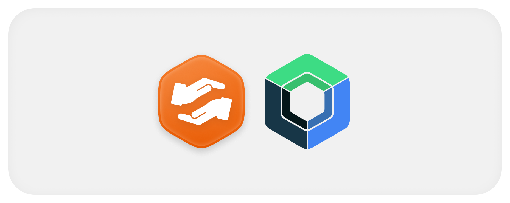

  

# Protocolos do aplicativo

O aplicativo consome APIs e não publica um OpenAPI HTTP próprio, e a sua única entrada externa é o callback registrado no manifest, já que os contratos de backend pertencem aos serviços.

## Callback e identidade

O redirect vem de `BuildConfig.AUTH_REDIRECT_URI`. O manifest define esquema por variante, host `auth` e caminho `/callback`. A Activity recebe `code` e `state`, remove a URI do Intent e encaminha a troca. O state deve coincidir com a pendência guardada, consumida uma vez.

A sequência REST usa `POST /auth/mobile/transactions`, `POST /auth/mobile/token`, `POST /auth/refresh` e `POST /auth/sessions/current/logout`, com a autorização feita no navegador e sem que o app solicite chave de serviço.

## Contratos consumidos

| Grupo | Uso |
|---|---|
| `api/projects` e sub-recursos | Consulta e criação de projeto, membros, atividades, histórico e fotos |
| Perfil e conexões no cadastro central | Dados da pessoa e das conexões |
| `messaging/conversations` | Lista, conversa direta e estado pessoal |
| `messaging/messages` | Histórico, envio, edição e exclusão |
| `messaging/updates` | Catch-up por cursor e época |
| `messaging/media` | Permissão de upload, conteúdo por redirecionamento 302 e página `{items, nextCursor}` de anexos disponíveis |
| `messaging/communities` | Comunidades por projeto/id, integrantes, papéis, status e subgrupos |
| `v1/address/geocode` | Endereço quando o flavor configura o destino |

Os clientes estão em [AuthApi](https://github.com/Solierrr/mobile-app/blob/main/app/src/main/kotlin/com/project/solaria_mobile/core/auth/AuthApi.kt), [ProjectApi](https://github.com/Solierrr/mobile-app/blob/main/app/src/main/kotlin/com/project/solaria_mobile/feature/project/data/ProjectApi.kt), [ProfileApi](https://github.com/Solierrr/mobile-app/blob/main/app/src/main/kotlin/com/project/solaria_mobile/feature/profile/data/ProfileApi.kt), [MessengerApi](https://github.com/Solierrr/mobile-app/blob/main/app/src/main/kotlin/com/project/solaria_mobile/feature/communication/data/MessengerApi.kt) e [RegistryApi](https://github.com/Solierrr/mobile-app/blob/main/app/src/main/kotlin/com/project/solaria_mobile/feature/discovery/data/RegistryApi.kt).

## Tempo real

A URL REST de mensagens é convertida em WebSocket no caminho `/messaging/ws`, e o Krossbow envia o Bearer no CONNECT com heartbeat de 10 segundos. Os eventos privados chegam por `/topic/users.{userId}.events`, e o cliente acompanha o ciclo de vida, desconectando ao ir para segundo plano.

Presença e digitação chegam pelo mesmo canal privado da conta. A digitação envia `/app/typing.started` e `/app/typing.stopped`. O transporte reconecta com espera crescente de 1 a 30 segundos. Ao recusar um token, renova pelo mesmo mecanismo de refresh do REST e tenta a nova credencial uma vez; uma nova recusa encerra a tentativa. Limite de sessões não dispara refresh. O chat e a lista exibem o estado de conexão.

## Erros

O cliente categoriza 400 e 422 como validação, 401 como sessão, 403 como permissão, 404 como ausência, 409 como conflito, 429 como limite e 5xx como servidor. Campos de validação vêm de `errors[].field`. O contrato dos servidores está em [erros HTTP](https://github.com/Solierrr/docs-warehouse/blob/main/docs/standards/ERRORS.md).

A fila limita recusas de sessão a três tentativas automáticas. Falhas ambíguas consultam o histórico, inclusive páginas anteriores, pelo `clientMessageId` antes de reenviar. O servidor não deduplica: isso reduz duplicatas, sem garantir envio único. Operações de grupo/comunidade com `*_UNCERTAIN` consultam o estado antes de liberar repetição.
## Mídia e comunidades

O upload usa um cliente sem interceptor de sessão, respeitando método e cabeçalhos do alvo assinado, inclusive a grafia insensível a maiúsculas de `Content-Type`. Fotos enviam `width`/`height`; áudio gravado usa AAC em MP4 e tamanho real; vídeo usa o aplicativo de câmera do sistema. O download continua autenticado no messenger, seguindo o redirecionamento do bucket sem Bearer no outro host.

A projeção de conversa traz `communityId` e `communityStatus`. Ao abrir pelo id, o app consulta `GET /messaging/communities/{id}` para confirmar o status que o DTO de detalhe não inclui. Comunidade arquivada tem compositor substituído por um aviso; status desconhecido mantém consulta até uma leitura bem-sucedida.

`GET /messaging/media?conversationId&limit&cursor` preserva o cursor opaco na API e no repositório. O carregamento automático dessa listagem no chat é opcional e não foi ativado: as imagens recentes continuam a baixar pelo histórico de mensagens.

Push `NEW_MESSAGE` abre `conversationId` (ou `chatId` legado). `notificationId` é opcional nesse caminho; outros tipos continuam na caixa de notificações. O id é validado antes de navegar e o conteúdo é autorizado pelo servidor ao abrir o chat.
